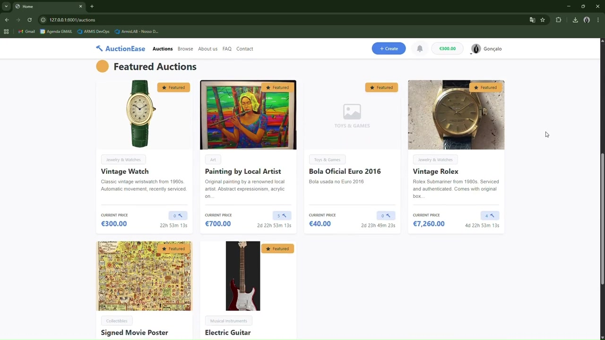

# AuctionEase

Online auction platform developed for the Database and Web Applications Laboratory (LBAW) course at FEUP, University of Porto, in 2025/2026. Sellers create and manage auctions, while buyers discover items, place bids and purchase through Buy Now.

[](docs/media/auctionease-demo.mp4)

[Watch the two-minute demo](docs/media/auctionease-demo.mp4).

## Features

- Auction creation, search, filters, watchlists and bidding history.
- Real-time bid notifications and chat between buyers and sellers.
- Wallet credits and Stripe payment integration in test mode.
- Account management, Google sign-in and seller reviews.
- Administration dashboard for users, categories and reports.

## Tech stack

PHP 8.2+, Laravel 12, PostgreSQL, Blade, JavaScript, Bootstrap/Bootswatch and Docker. Integrations include Pusher, Google OAuth and Stripe.

## Run locally

Requires PHP with `pdo_pgsql`, Composer, Node.js 20.19+ or 22.12+, and Docker.

```bash
cp .env.example .env
docker compose up -d postgres
composer install
npm ci
php artisan key:generate
php artisan db:seed
npm run build
php artisan serve
```

Open <http://localhost:8000>. Seed only a fresh local database. Run `php artisan schedule:work` in a second terminal to update auction statuses. Google sign-in, payments and real-time features require your own provider credentials in `.env`.

## Documentation

The [project wiki](https://gitlab.up.pt/lbaw/archive/lbaw2526/lbaw25172/-/wikis/home) contains the requirements, database design, architecture and final product documentation. Validation reports are available in [`reports/`](reports/).

## Authors

David Rodrigues, Gonçalo Ferreira, João Furtado and Matilde Duarte.
